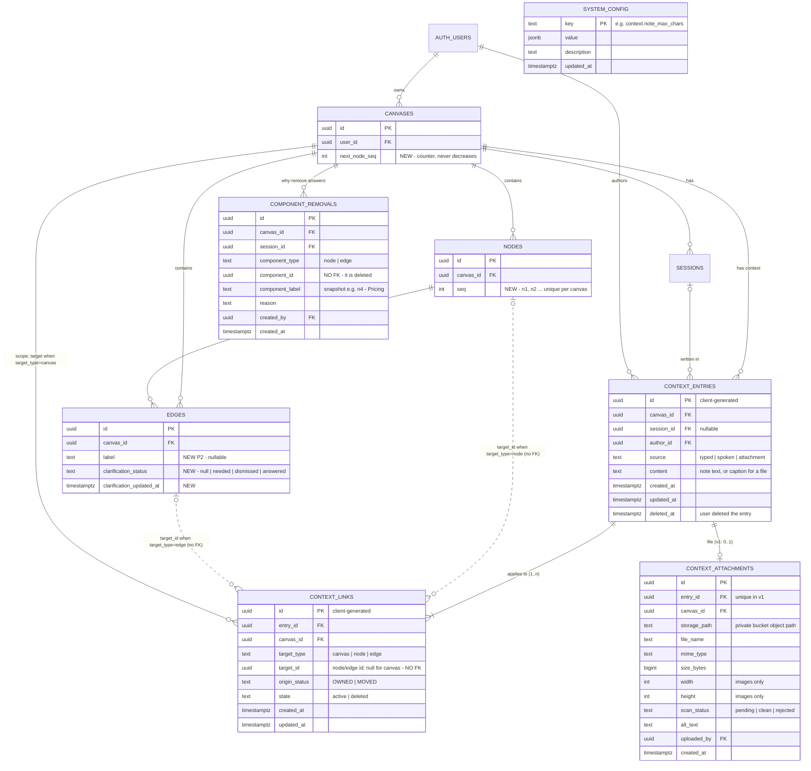

# Text-Only Context Capture — expected schema (rev 3)

## Decisions so far

| Topic | Decision |
|---|---|
| Audit log (`context_decisions`) | **Dropped.** |
| "Why remove this?" answers | **`component_removals` table.** Nodes and edges stay **hard-deleted**; no `deleted_at` / `delete_reason` on them. |
| Link liveness | `context_links.state = 'active' \| 'deleted'`: `deleted` when the link was removed, its entry was deleted, or its node/edge was deleted. |
| Link origin | `context_links.origin_status = 'OWNED' \| 'MOVED'`. |
| Naming | `target_kind` → **`target_type`**. |
| Attachments | **Separate `context_attachments` table**, holding `entry_id` (option B). **One file per entry in v1.** |
| "?" on edges | `edges.clarification_status` + SSE message. No separate table. |
| Tunables | Global `system_config` table. |
| Drafts | Browser `localStorage` only. **No drafts table.** |

## Tables at a glance

| Table / change | Priority |
|---|---|
| `context_entries` | P0 |
| `context_links` | P0 |
| `nodes.seq` + `canvases.next_node_seq` | P0 |
| `edges.clarification_status` | P1 |
| `component_removals` | P1 |
| `system_config` | P1 |
| `context_attachments` | Table now; used after voice mode |
| `edges.label` | P2 |

---

## 1. ER diagram



---

## 2. Tables

### 2.1 `context_entries` — one piece of context (P0)

**Why:** one store for typed notes, voice transcripts and attachments,
differing only by `source` (spec §5.9, §8).

| Column | Type | Rule |
|---|---|---|
| `id` | uuid PK | Client-generated, so the UI is optimistic with no read-back. |
| `canvas_id` | FK → canvases, cascade | Ownership and RLS. |
| `session_id` | FK → sessions, set null, nullable | Session it was written in. |
| `author_id` | FK → auth.users | |
| `source` | text, check in (`typed`,`spoken`,`attachment`) | |
| `content` | text, nullable, ≤ 1000 chars | Required for `typed`/`spoken`. Optional caption for `attachment`. Never rewritten by the system. |
| `created_at`, `updated_at` | timestamptz | |
| `deleted_at` | timestamptz, nullable | The **user deleted this entry** (undoable). |

```sql
check (source = 'attachment' or (content is not null and char_length(content) between 1 and 1000))
```

**Why keep `deleted_at` here when links also have `state`:** it records *why*
the entry is gone. "The user deleted the note" and "the node it was on was
deleted" both make the links `deleted`. Only the first is undone by "restore
note", so the restore needs to tell them apart.

**Relationships:**
- `canvases` 1—N `context_entries`
- `sessions` 1—N `context_entries` (optional)
- `auth.users` 1—N `context_entries`
- `context_entries` 1—1..N `context_links`
- `context_entries` 1—0..1 `context_attachments`

### 2.2 `context_links` — where an entry applies (P0)

**Why:** a note and what it points at are separate. `/all` is **one entry + N
links**, so one undo removes it everywhere and agents see it on each node.
v2 group notes are just more links.

| Column | Type | Rule |
|---|---|---|
| `id` | uuid PK | Client-generated. |
| `entry_id` | FK → context_entries, cascade | |
| `canvas_id` | FK → canvases, cascade | For RLS and per-canvas queries without a join. |
| `target_type` | text, check in (`canvas`,`node`,`edge`) | `canvas` = the "Canvas context" bar. |
| `target_id` | uuid, nullable, **no FK** | The node or edge id. Null iff `target_type = 'canvas'`. |
| `origin_status` | text, check in (`OWNED`,`MOVED`) | `OWNED` = written there directly. `MOVED` = the user moved it there ("a move is recorded as a user decision", §5.5). |
| `state` | text, check in (`active`,`deleted`), default `active` | `deleted` when the link is removed, its entry is deleted, or its node/edge is deleted. |
| `created_at`, `updated_at` | timestamptz | `updated_at` bumps on move and on state change. |

```sql
check ((target_type = 'canvas') = (target_id is null))

create unique index context_links_one_active
  on context_links (entry_id, target_type, coalesce(target_id, canvas_id))
  where state = 'active';
create index context_links_target on context_links (target_type, target_id) where state = 'active';
```

**Why `target_id` has no foreign key (a consequence of your decisions):**
- Nodes and edges are hard-deleted, and we want the link row to stay behind as `state='deleted'`.
- A foreign key would either delete the link along with the node, so there'd be no row left to mark, or empty out `target_id`, so we'd lose which node it was.
- So the link keeps the id with no FK, and a database trigger marks it `deleted` when its node or edge is deleted.

```sql
-- When a node/edge row is hard-deleted, its links go 'deleted'.
create function context_links_on_target_delete() returns trigger language plpgsql as $$
begin
  update context_links set state = 'deleted', updated_at = now()
   where target_type = TG_ARGV[0] and target_id = old.id and state = 'active';
  return old;
end $$;
create trigger nodes_context_links_delete after delete on nodes
  for each row execute function context_links_on_target_delete('node');
create trigger edges_context_links_delete after delete on edges
  for each row execute function context_links_on_target_delete('edge');
```

**Every action and what it does to the links:**

| Action | Links |
|---|---|
| Save note on n2 | insert 1 link, `OWNED`, `active` |
| `/all` note | insert N links, `OWNED`, `active` |
| Move note n2 → n5 | update in place: `target_id = n5`, `origin_status = 'MOVED'` |
| Undo move | update back: `target_id = n2`, previous `origin_status` (the frontend holds both during the undo window) |
| Delete note | `entries.deleted_at = now()` + all its active links → `deleted` (one RPC) |
| Undo delete note | `deleted_at = null` + links back to `active`, **only those whose node/edge still exists** |
| Node/edge deleted | trigger: its links → `deleted` (the frontend deletes the row only after its 5 s undo window, so an undone delete never reaches the DB) |
| Unlink one node from a group note (v2) | that link → `deleted` |

**What `active` means to readers:** badge counts, the panel list and agents
read only `state = 'active'` links of entries with `deleted_at is null`.

### 2.3 `context_attachments` — the file behind an attachment entry (option B)

**Why a separate table:** it keeps `context_entries` free of file columns. The
file data (path, type, size, scan) lives only here.

| Column | Type | Rule |
|---|---|---|
| `id` | uuid PK | |
| `entry_id` | FK → context_entries, **cascade**, **unique (v1)** | The owning entry. Unique enforces one file per entry; drop the unique index later to allow several. |
| `canvas_id` | FK → canvases, cascade | RLS. |
| `storage_path` | text | Object path in a **private** Supabase Storage bucket, `context/<canvas_id>/<entry_id>/<file_name>`. The frontend gets a short-lived signed URL to open it. Never store a public URL. |
| `file_name`, `mime_type`, `size_bytes` | text, text, bigint | The file chip in the panel. |
| `width`, `height` | int, nullable | Images only: lets the panel reserve space for the thumbnail before it loads. |
| `scan_status` | text, check in (`pending`,`clean`,`rejected`) | Safety scan. Only `clean` files can be opened or sent to agents. |
| `alt_text` | text, nullable | Screen-reader description (spec §6.4). |
| `uploaded_by` | FK → auth.users | |
| `created_at` | timestamptz | |

**Why option B (`entry_id` on the attachment row):**
- Deleting the entry deletes its attachment row automatically, so no file rows are left behind.
- Allowing several files per entry later is just dropping one unique index.

**One file per entry (v1):** three files dropped at once make three entries, each
with its own link, badge count, move, delete and undo, as the spec describes
attachments. Storage cost is identical either way: one object per file.

**Upload flow:**
1. The frontend uploads the file to Storage.
2. RPC `create_context_entry` inserts the entry (`source='attachment'`), its links, and the attachment row with `scan_status='pending'`.
3. The frontend notifies `context.created`.
4. The backend scans the file and sets `clean` or `rejected`.
5. The backend prepares the file for agents.

The bucket's storage rules use the same canvas-owner rule.

### 2.4 `nodes.seq` + `canvases.next_node_seq` — node numbers (P0)

**Why:** `@n2` and the `n3` label need a number that is unique per canvas, never
reused, and arrives with the node. A counter is needed because "highest number
+ 1" would reuse a deleted node's number.

```sql
alter table canvases add column next_node_seq int not null default 1;
alter table nodes    add column seq int;
create unique index nodes_canvas_seq on nodes (canvas_id, seq);

create function assign_node_seq() returns trigger language plpgsql as $$
begin
  if new.seq is null then
    update canvases set next_node_seq = next_node_seq + 1
      where id = new.canvas_id
      returning next_node_seq - 1 into new.seq;
  end if;
  return new;
end $$;
create trigger nodes_assign_seq before insert on nodes
  for each row execute function assign_node_seq();
```

- Assigned by a trigger, because the frontend inserts nodes directly. It's read back via `insert(...).select('seq')` and in hydration.
- Backfill existing nodes in `created_at` order.

### 2.5 `edges.clarification_status` — the "?" (P1)

```sql
alter table edges
  add column clarification_status text check (clarification_status in ('needed','dismissed','answered')),
  add column clarification_updated_at timestamptz;
```

| Value | Meaning | Set by |
|---|---|---|
| `null` | Never asked | default |
| `needed` | Show the "?" and a "Needs you" item | **Backend**: no label, no active note, and `edge.clarification_delay_ms` passed since creation. It also pushes SSE `{ type: 'edge_clarification', edge_id, status: 'needed' }`. |
| `dismissed` | User skipped it; never ask again | Frontend |
| `answered` | A note or label was added | Frontend, or the backend on `context.created` for the edge |

- The frontend hides the "?" while that edge is focused.
- The frontend shows at most `edge.needs_you_max_visible` at once.

### 2.6 `component_removals` — "Why remove this?" (P1)

**Why its own table:** nodes and edges are hard-deleted, and the spec requires the
answer be stored against the deleted component, never on one that still
exists. This row outlives the component.

| Column | Type | Rule |
|---|---|---|
| `id` | uuid PK | |
| `canvas_id` | FK → canvases, cascade | |
| `session_id` | FK → sessions, set null | |
| `component_type` | text, check in (`node`,`edge`) | Same wording as `target_type`. |
| `component_id` | uuid, **no FK** | The component is gone, by design. |
| `component_label` | text | Snapshot (`n4 · Pricing`) so the record stays readable. |
| `reason` | text, 1–1000 chars | |
| `created_by` | FK → auth.users | |
| `created_at` | timestamptz | |

Written only when the user types a reason.

### 2.7 `system_config` — global tunables (P1)

```sql
create table system_config (
  key text primary key,
  value jsonb not null,
  description text,
  updated_at timestamptz not null default now()
);
```

| key | default |
|---|---|
| `context.composer_max_lines` | 5 |
| `context.canvas_bar_max_lines` | 5 |
| `context.hash_autocomplete_rows` | 5 |
| `context.note_max_chars` | 1000 |
| `context.panel_note_collapsed_lines` | 4 |
| `context.removal_prompt_visible_ms` | 10000 |
| `edge.clarification_delay_ms` | 10000 |
| `edge.needs_you_max_visible` | 3 |
| `attachment.allowed_mime_types` | later |
| `attachment.max_size_bytes` | later |

Readable by authenticated users; writable by service role only. The frontend reads all keys on load.

### 2.8 `edges.label` (P2)

```sql
alter table edges add column label text check (char_length(label) <= 80);
```
The spec has a short label typed on the edge itself. A labelled edge doesn't qualify for clarification.

### Not in the database

- **Drafts:** browser `localStorage` only.
- **Note edit history:** agents see only the latest text.
- **Where a note was moved from:** `origin_status = 'MOVED'` says *that* it moved, not from where.

---

## 3. RLS

The canvas owner, as today:
```sql
using (exists (select 1 from canvases c where c.id = <t>.canvas_id and c.user_id = auth.uid()))
```
- `context_entries`, `context_links`, `context_attachments`: select / insert / update. No client hard delete.
- `component_removals`: insert + select.
- `edges.clarification_status`: the owner may set `dismissed` / `answered`. `needed` is backend-only (service role).
- `system_config`: select for authenticated users.
- Storage bucket `context`: owner-only under `context/<canvas_id>/…`.

## 4. What agents read

```sql
create view agent_context as
select e.id as entry_id, e.canvas_id, e.source, e.content,
       a.storage_path, a.mime_type,
       l.target_type, l.target_id, l.origin_status,
       e.created_at, e.updated_at
from context_entries e
join context_links l      on l.entry_id = e.id and l.state = 'active'
left join context_attachments a on a.entry_id = e.id
where e.deleted_at is null
  and (e.source <> 'attachment' or a.scan_status = 'clean');
```
- A `/all` entry appears once per node.
- `target_type = 'canvas'` rows feed the rolling canvas summary.

## 5. Writes the frontend makes (write-then-notify)

| Action | Supabase write | Notify `POST /api/canvas-event` |
|---|---|---|
| Save note / attach file | RPC `create_context_entry(entry, links[], attachment?)` | `context.created` |
| Edit | update `content`, `updated_at` | `context.updated` |
| Delete note | RPC `delete_context_entry(entry_id)` (sets `deleted_at` + links → `deleted`) | `context.deleted` |
| Undo delete | RPC `restore_context_entry(entry_id)` | `context.restored` |
| Move / undo move | update the link: `target_id`, `origin_status` | `context.moved` |
| Dismiss "?" | `edges.clarification_status = 'dismissed'` | none |
| "Why remove this?" | insert `component_removals` | none |

The RPCs keep multi-row writes atomic.

## 6. Open questions for the backend

1. Is a trigger OK for `nodes.seq`?
2. Is the trigger that marks links `deleted` when their node/edge is deleted OK?
3. Is the `edge_clarification` SSE message shape OK? Time from edge creation?
4. Storage bucket name/path convention and the scan mechanism for attachments.
