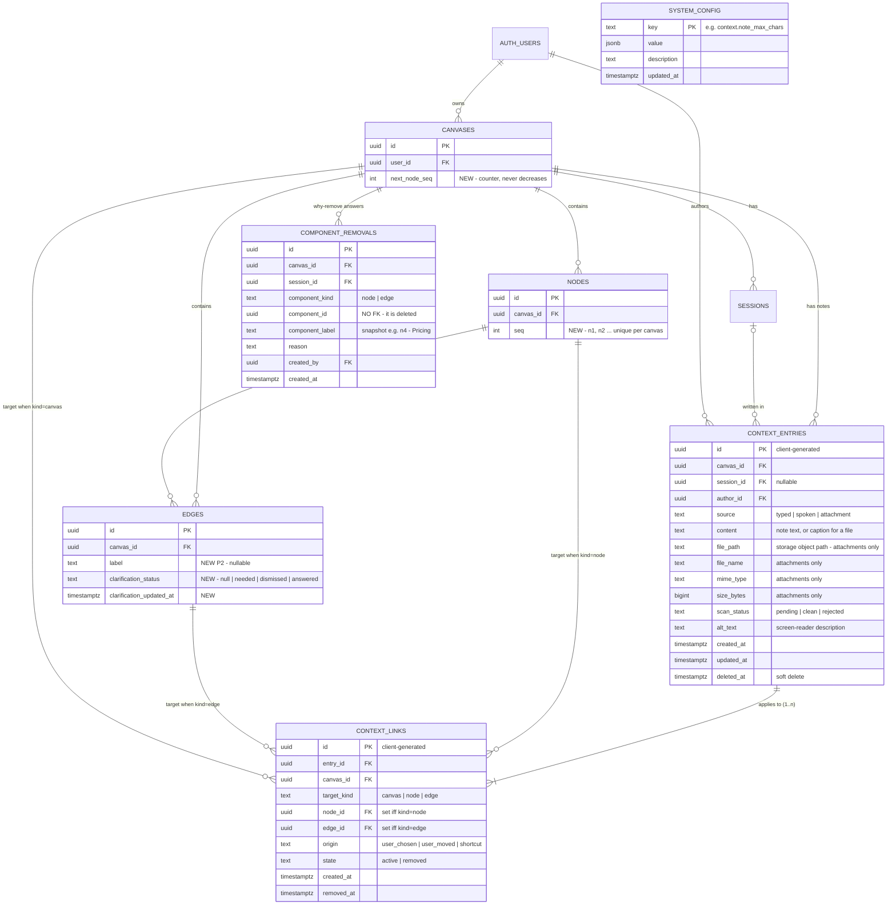

# Text-Only Context Capture — expected schema (rev 2)

## What changed in rev 2

| Rev 1 | Rev 2 | Why |
|---|---|---|
| `context_decisions` (general audit log) | **Removed.** Replaced by a small `component_removals` table | Note history is already on the rows themselves (`deleted_at`, removed links kept with `removed_at`, `origin='user_moved'`). The only thing with nowhere else to live is the "Why remove this?" answer. |
| `edge_prompts` table | **Removed.** Replaced by `edges.clarification_status` | The "?" is a property of the edge. The backend sets it and pushes an SSE message, and a reload reads it with the edge row. |
| `context_settings` table | **Renamed and widened:** global `system_config` | One place for every tunable number (context, edges, later others). |
| `context_drafts` table | **Removed** | No cross-device drafts for now. Drafts stay in browser `localStorage` only (already how the frontend works). |
| `context_attachments` (later, separate table) | **File columns on `context_entries`** | An attachment *is* a context entry; it just needs a place for the file link. |

## Tables at a glance

| Table / change | Priority |
|---|---|
| `context_entries` (notes, voice, attachments) | P0 |
| `context_links` | P0 |
| `nodes.seq` + `canvases.next_node_seq` | P0 |
| `edges.clarification_status` | P1 |
| `component_removals` | P1 |
| `system_config` | P1 |
| `edges.label` | P2 |
| Attachment columns on `context_entries` | Columns now, used after voice mode |

---

## 1. ER diagram



---

## 2. Tables

### 2.1 `context_entries` — one piece of context: typed, spoken, or a file (P0)

**Why it exists:** the spec asks for one store for typed notes, voice transcripts and
attachments, differing only by `source`. Agents read one table with one set of rules.

| Column | Type | Rule |
|---|---|---|
| `id` | uuid PK | Client-generated, like nodes/edges, so the UI is optimistic and there's no read-back. |
| `canvas_id` | FK → canvases, cascade | Ownership and RLS. |
| `session_id` | FK → sessions, set null, nullable | Which session it was written in. |
| `author_id` | FK → auth.users | |
| `source` | text, check in (`typed`,`spoken`,`attachment`) | |
| `content` | text, nullable, ≤ 1000 chars | Note text. For an attachment it is the optional caption. Never rewritten by the system. |
| `file_path` | text, nullable | **The file link.** The object path in a private Supabase Storage bucket, e.g. `context/<canvas_id>/<entry_id>/<file_name>`. |
| `file_name`, `mime_type`, `size_bytes` | nullable | Shown as the file chip (name, type, size) in the panel. |
| `scan_status` | text, nullable, check in (`pending`,`clean`,`rejected`) | Spec: "files are checked for safety before anyone can open them". Only `clean` files are openable or sent to agents. |
| `alt_text` | text, nullable | Spec: "every attachment has a name or description that a screen reader can read." |
| `created_at`, `updated_at` | timestamptz | |
| `deleted_at` | timestamptz, nullable | Soft delete, so undo works. **Agents never read a row with this set.** |

```sql
check (
  (source in ('typed','spoken') and content is not null and char_length(content) between 1 and 1000
     and file_path is null) or
  (source = 'attachment' and file_path is not null and file_name is not null
     and mime_type is not null and size_bytes is not null)
)
```

**How attachments work:**
- **One file = one entry.** Three files dropped at once are three entries. Each can be linked, moved, deleted and undone on its own, exactly like a note, and each counts once in the badge.
- **Store the path, not a URL.** The bucket is private. The frontend asks for a short-lived signed URL when the user opens or previews the file. A stored public URL would leak, and a stored signed URL would expire.
- **Upload flow:**
  1. Frontend uploads to Storage at `context/<canvas_id>/<entry_id>/…`.
  2. Frontend inserts the entry with `scan_status='pending'` and its links.
  3. Frontend notifies `context.created`.
  4. Backend scans the file and sets `clean` or `rejected`.
  5. Backend prepares the file for agents (thumbnails, OCR, text extraction).
- Storage RLS on the bucket uses the same canvas-owner rule as the tables.
- Allowed types, sizes and per-plan limits are values in `system_config`, not schema.

If the backend expects many-files-per-entry later, these columns move out to a
`context_files(entry_id, …)` table. Until then, inline is simpler.

**Relationships:**
- `canvases` 1—N `context_entries`
- `sessions` 1—N `context_entries` (optional)
- `auth.users` 1—N `context_entries`
- `context_entries` 1—1..N `context_links`

### 2.2 `context_links` — where a piece of context applies (P0)

**Why it exists:**
- A note and what it points at are separate things (spec: "one entry can have many links; a link can be moved or removed without changing the text").
- `/all` is **one entry + N links**, not N copies, so one undo removes it everywhere and agents see it on every node.
- v2 group notes are just more links.

| Column | Type | Rule |
|---|---|---|
| `id` | uuid PK | Client-generated. |
| `entry_id` | FK → context_entries, cascade | |
| `canvas_id` | FK → canvases, cascade | Denormalised so RLS and per-canvas queries don't need a join. |
| `target_kind` | text, check in (`canvas`,`node`,`edge`) | `canvas` = the "Canvas context" bar. |
| `node_id` | FK → nodes, **on delete cascade**, nullable | Set iff `target_kind='node'`. |
| `edge_id` | FK → edges, **on delete cascade**, nullable | Set iff `target_kind='edge'`. |
| `origin` | text, check in (`user_chosen`,`user_moved`,`shortcut`) | How the link came to be. |
| `state` | text, check in (`active`,`removed`) | `removed` = moved away or unlinked. The row is kept, so the move is undoable and its history is visible. |
| `created_at`, `removed_at` | timestamptz | |

```sql
check (
  (target_kind = 'canvas' and node_id is null and edge_id is null) or
  (target_kind = 'node'   and node_id is not null and edge_id is null) or
  (target_kind = 'edge'   and edge_id is not null and node_id is null)
)
create unique index context_links_one_active
  on context_links (entry_id, target_kind, coalesce(node_id, edge_id, canvas_id))
  where state = 'active';
```

- **Move:** old link → `removed` + `removed_at`, then insert a new link with `origin='user_moved'`. Undo flips them back. The old row (removed, with its timestamp) and the new row (`user_moved`) together are the record of the move.
- **Component deleted:** the cascade removes its links, so notes go with it. The frontend's 5 s undo window happens before the node row is deleted, so an undone delete never touches the database.

### 2.3 `nodes.seq` + `canvases.next_node_seq` — node numbers (P0)

**Why:**
- `@n2` and the `n3` label need a number that is unique per canvas, never reused and never renumbered, and that arrives with the node data.
- A counter on the canvas is needed because "highest number + 1" would reuse a deleted node's number.
- Not related to `sessions.latest_seq`.

```sql
alter table canvases add column next_node_seq int not null default 1;
alter table nodes    add column seq int;
create unique index nodes_canvas_seq on nodes (canvas_id, seq);

create function assign_node_seq() returns trigger language plpgsql as $$
begin
  if new.seq is null then
    update canvases set next_node_seq = next_node_seq + 1
      where id = new.canvas_id
      returning next_node_seq - 1 into new.seq;
  end if;
  return new;
end $$;
create trigger nodes_assign_seq before insert on nodes
  for each row execute function assign_node_seq();
```

- Assigned by a database trigger, because the frontend inserts nodes directly. The frontend reads it back with `insert(...).select('seq')` and in hydration.
- Backfill existing nodes per canvas in `created_at` order.

### 2.4 `edges.clarification_status` — the "?" on an edge (P1)

**Why it lives on `edges`:** it is a property of the edge. It comes back with the
edge row on reload, it's pushed live over SSE, and it dies with the edge. No
extra table.

```sql
alter table edges
  add column clarification_status text
    check (clarification_status in ('needed','dismissed','answered')),
  add column clarification_updated_at timestamptz;
```

| Value | Meaning | Who sets it |
|---|---|---|
| `null` | Never asked | Default |
| `needed` | Show the "?" and a "Needs you" item | **Backend**, when the edge qualifies: no label, no note, and ~10 s have passed (from `system_config`). It also pushes SSE `{ type: 'edge_clarification', edge_id, status: 'needed' }`. |
| `dismissed` | User skipped it; **never ask again** | Frontend (update on the edge row) |
| `answered` | User wrote a note or label for it | Frontend, or the backend on `context.created` for that edge |

**Why it's a status and not a boolean:** a single `needs_clarification` true/false
can't tell "never asked" apart from "user dismissed it". The spec says a dismissed
edge "is not asked again unless the user opens it". With only a boolean, the
backend would flip it back to true on the next check. One text column with three
values covers it.

**Two things to agree on:**
- **Timing.** The backend doesn't know the user's focus. It times from edge creation (or the last edit). The frontend hides the "?" while that edge is focused, which keeps the spec's "only after the user has moved on".
- **Cap of 3 visible.** The backend may set as many edges to `needed` as qualify. The frontend shows at most `edge.needs_you_max_visible` of them at once. That's a display cap, read from config.
- **SSE:** `edge_clarification` is a new `RedisMessage` type. The frontend already ignores unknown types safely, so it can ship in either order.

### 2.5 `component_removals` — "Why remove this?" answers (P1)

**Why it exists:** the spec requires the answer to be "stored as a record linked to
the deleted component, never on a component that still exists". The node/edge row
is hard-deleted, so the answer cannot be a column on it. It needs its own row
that outlives the component.

| Column | Type | Rule |
|---|---|---|
| `id` | uuid PK | |
| `canvas_id` | FK → canvases, cascade | |
| `session_id` | FK → sessions, set null | |
| `component_kind` | text, check in (`node`,`edge`) | |
| `component_id` | uuid, **no FK** | The component is gone, by design. |
| `component_label` | text | Snapshot (e.g. `n4 · Pricing`) so the record is readable after the row is gone. |
| `reason` | text, 1–1000 chars | |
| `created_by` | FK → auth.users | |
| `created_at` | timestamptz | |

Written only when the user actually types a reason. Ignoring the prompt writes nothing.

### 2.6 `system_config` — global tunables (P1)

**Why:** the spec's bracketed numbers must change without a release, and edges and
other features have their own knobs. So this is one global key/value table,
namespaced by feature.

```sql
create table system_config (
  key text primary key,          -- 'context.note_max_chars'
  value jsonb not null,
  description text,
  updated_at timestamptz not null default now()
);
-- RLS: select for authenticated users; insert/update for service role only.
```

| key | default |
|---|---|
| `context.composer_max_lines` | 5 |
| `context.canvas_bar_max_lines` | 5 |
| `context.hash_autocomplete_rows` | 5 |
| `context.note_max_chars` | 1000 |
| `context.panel_note_collapsed_lines` | 4 |
| `context.removal_prompt_visible_ms` | 10000 |
| `edge.clarification_delay_ms` | 10000 |
| `edge.needs_you_max_visible` | 3 |
| `attachment.allowed_mime_types` | later |
| `attachment.max_size_bytes` | later |

The frontend reads all keys once on load. The existing `NEXT_PUBLIC_CONTEXT_*`
env values remain only as a fallback.

### 2.7 `edges.label` (P2)

```sql
alter table edges add column label text check (char_length(label) <= 80);
```
- The spec has a short label typed on the edge itself (the edge, not a note).
- A labelled edge doesn't qualify for clarification.

### Not in the database (decided)

- **Drafts:** browser `localStorage` only, per canvas. They survive refresh and lost connection; no cross-device drafts. This is already implemented.
- **Edit history of notes:** agents see only the latest text (spec). `updated_at` tells that an edit happened, and the previous text isn't kept. Undo of an edit is handled on the client during the undo window.

---

## 3. RLS

The same boundary as today, **the canvas owner**, on every new table and column:
```sql
using (exists (select 1 from canvases c where c.id = <t>.canvas_id and c.user_id = auth.uid()))
```
- `context_entries` / `context_links`: select / insert / update. No client hard delete; deletes are soft.
- `component_removals`: insert + select.
- `edges.clarification_status`: the owner may update it to `dismissed` / `answered`. Setting `needed` is the backend's job (service role).
- `system_config`: select for authenticated users.
- Storage bucket `context`: read/write only under `context/<canvas_id>/…` for that canvas's owner.

## 4. What agents read

```sql
create view agent_context as
select e.id as entry_id, e.canvas_id, e.source, e.content, e.file_path, e.mime_type,
       e.created_at, e.updated_at, l.target_kind, l.node_id, l.edge_id
from context_entries e
join context_links  l on l.entry_id = e.id
where e.deleted_at is null
  and l.state = 'active'
  and (e.source <> 'attachment' or e.scan_status = 'clean');
```
- A `/all` entry appears once per linked node.
- Rows with `target_kind='canvas'` feed the rolling canvas summary.

## 5. Writes the frontend will make (write-then-notify)

| Action | Supabase write | Notify `POST /api/canvas-event` |
|---|---|---|
| Save note / attach file | RPC `create_context_entry(entry, links[])` (after Storage upload for a file) | `context.created` |
| Edit | update `content`, `updated_at` | `context.updated` |
| Delete / undo | `deleted_at = now()` / `null` | `context.deleted` / `context.restored` |
| Move / undo | RPC `move_context_link(link_id, kind, target_id)` | `context.moved` |
| Dismiss "?" | `edges.clarification_status = 'dismissed'` | none |
| "Why remove this?" | insert `component_removals` | none |

The two RPCs keep the multi-row writes atomic, so a failure can't leave a note
with no links.

## 6. Open questions for the backend

1. Is the `node_id` / `edge_id` FK approach OK, versus a polymorphic `target_id`?
2. Is a trigger OK for `nodes.seq`?
3. Is the `edge_clarification` SSE message shape OK? Time from edge creation, or from last edit?
4. One file per entry (inline columns): OK for the voice/attachment plan?
