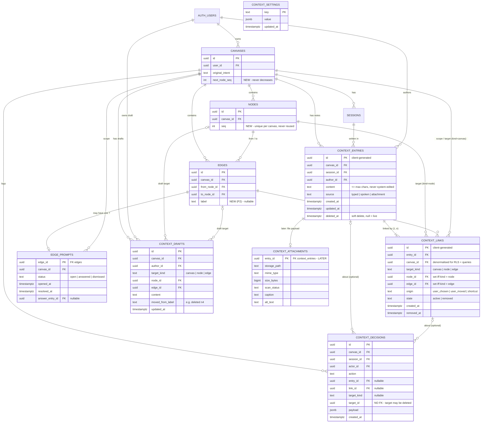

# Text-Only Context Capture — expected schema

This is the database shape the frontend expects. New tables hang off the
existing `canvases`, `sessions`, `nodes`, `edges` and `auth.users`. Nothing
existing is renamed or removed. Two existing tables get one new column each
(`nodes.seq`, `edges.label`), and `canvases` gets a counter.

**Tiers**
- **P0 — needed for v1 to work for real:** `context_entries`, `context_links`, `nodes.seq` + `canvases.next_node_seq`.
- **P1:** `context_decisions`, `edge_prompts`, `context_settings`.
- **P2:** `context_drafts`, `edges.label`.
- **Later (not v1):** `context_attachments`.

---

## 1. ER diagram



**The core idea in one line:** a *note* (`context_entries`) is written once,
and *where it applies* (`context_links`) is a separate list. One note can
point at one node, one edge, the canvas, or every node (`/all`) without
being copied.

---

## 2. Tables — why each exists and how it relates

### 2.1 `context_entries` — the note itself (P0)

**Why:** spec §5.9 and §8 require *one* store for typed notes, voice transcripts
and (later) attachments, differing only by `source`. Agents read context from
this one place, with one set of rules.

| Column | Type | Rule / reason |
|---|---|---|
| `id` | uuid PK | **Client-generated**, same as nodes/edges, so the frontend can render optimistically and notify with the id and no read-back. |
| `canvas_id` | uuid FK → `canvases.id` ON DELETE CASCADE | Every note belongs to one canvas. RLS hangs off this. |
| `session_id` | uuid FK → `sessions.id` ON DELETE SET NULL, nullable | The session it was written in, for Session Complete / Observer and "what changed this session". Nullable so a session cleanup never destroys notes. |
| `author_id` | uuid FK → `auth.users.id` | Spec: notes record author. Single-author in v1; it matters once canvases are shared. |
| `content` | text NOT NULL, `char_length(content) between 1 and 1000` | The note text. The 1,000 limit is enforced here too, not just in the UI. **Never rewritten by the system** (§5.8). |
| `source` | text NOT NULL, check in (`typed`,`spoken`,`attachment`) | Shown in the panel and used by agents. |
| `created_at` / `updated_at` | timestamptz | `updated_at` bumps on edit. Agents always see the latest content (no version table needed in v1). |
| `deleted_at` | timestamptz null | **Soft delete.** Delete must be undoable in one step (§5.8), so this is set, not a row delete. **Agents must never read a row with this set.** |

**Relationships**
- `canvases` 1 — N `context_entries`
- `sessions` 1 — N `context_entries` (optional)
- `auth.users` 1 — N `context_entries`
- `context_entries` 1 — **1..N** `context_links` (a live note always has at least one active link)

### 2.2 `context_links` — where a note applies (P0)

**Why:**
- A note and *where it points* are different things. Spec §4: "One entry can have many links. A link can be moved or removed without changing the text."
- `/all` must be **one note with N links**, not N copies, so one undo removes it everywhere (§5.3) and agents see it on each node (§5.8).
- Moving a note must be recorded as a user decision.
- v2 group notes are just more links. No schema change.

| Column | Type | Rule / reason |
|---|---|---|
| `id` | uuid PK | Client-generated. |
| `entry_id` | uuid FK → `context_entries.id` ON DELETE CASCADE | The note this link belongs to. |
| `canvas_id` | uuid FK → `canvases.id` ON DELETE CASCADE | Denormalised so RLS and "all notes on this canvas" don't need a join through entries. Must equal the entry's canvas. |
| `target_kind` | text check in (`canvas`,`node`,`edge`) | `canvas` = background context ("Canvas context" bar). |
| `node_id` | uuid FK → `nodes.id` **ON DELETE CASCADE**, nullable | Set **iff** `target_kind = 'node'`. |
| `edge_id` | uuid FK → `edges.id` **ON DELETE CASCADE**, nullable | Set **iff** `target_kind = 'edge'`. |
| `origin` | text check in (`user_chosen`,`user_moved`,`shortcut`) | Spec §8 "Links": how the link came to exist. |
| `state` | text check in (`active`,`removed`) default `active` | `removed` = moved away, or unlinked. Kept (not deleted) so a move is undoable and auditable. |
| `created_at`, `removed_at` | timestamptz | |

**Constraints**
```sql
check (
  (target_kind = 'canvas' and node_id is null and edge_id is null) or
  (target_kind = 'node'   and node_id is not null and edge_id is null) or
  (target_kind = 'edge'   and edge_id is not null and node_id is null)
)
-- one active link per (entry, target)
create unique index context_links_one_active
  on context_links (entry_id, target_kind, coalesce(node_id, edge_id, canvas_id))
  where state = 'active';
```

**Why real FKs (`node_id` / `edge_id`) instead of one polymorphic `target_id`:**
- Postgres can enforce that the target exists.
- Deleting a node/edge automatically cleans its links (spec §5.7: "notes on a deleted component go with it").
- Agent queries join straight to `nodes`/`edges`.

The undo-delete case still works: the frontend holds a delete for a 5 s undo
window **before** it deletes the node row, so an undone delete never touches
the database. Once the row is really deleted, the cascade removes its links.
A `/all` note keeps its links to the other nodes. An entry left with no
active links is simply not shown anywhere; the backend may soft-delete it.

**Moving a note** = in one transaction, set the old link to `state='removed'`
and insert a new link with `origin='user_moved'`. **Undo of a move** flips
them back. Both steps are logged in `context_decisions`.

**Relationships**
- `context_entries` 1 — N `context_links`
- `nodes` 1 — N `context_links`
- `edges` 1 — N `context_links`
- `canvases` 1 — N `context_links`

### 2.3 `nodes.seq` + `canvases.next_node_seq` — sequence numbers (P0)

**Why:**
- `@n2` aims a note at node 2. The `n3` label on every node must be stable, **unique per canvas, never reused, never renumbered** (§5.3), and must arrive with the node data (§8).
- `max(seq)+1` is not enough: it reuses the number of a deleted last node. Hence a counter on the canvas.
- Not to be confused with `sessions.latest_seq` (SSE ordering), which is unrelated.

```sql
alter table canvases add column next_node_seq int not null default 1;
alter table nodes    add column seq int;
create unique index nodes_canvas_seq on nodes (canvas_id, seq);

-- BEFORE INSERT trigger on nodes: assign from the canvas counter
create function assign_node_seq() returns trigger language plpgsql as $$
begin
  if new.seq is null then
    update canvases set next_node_seq = next_node_seq + 1
      where id = new.canvas_id
      returning next_node_seq - 1 into new.seq;
  end if;
  return new;
end $$;
```

**Who assigns:** the **DB trigger**. The frontend inserts nodes directly into
Supabase, so an API-side assigner would race. The frontend reads `seq` back
with `insert(...).select('seq')` and in the hydration select.

- A duplicated node gets a new number automatically.
- Backfill existing rows per canvas in `created_at` order, then set `next_node_seq = max + 1`.

**Relationship:** a column on `nodes`; the counter lives on `canvases` (1 — N).

### 2.4 `context_decisions` — decision log (P1)

**Why:** spec §8 backend responsibility, "the decision log of user actions":
- note created / edited / moved / deleted / restored;
- "Why do these connect?" answered / dismissed;
- "Why remove this?" reasons.

It's an append-only audit and learning signal for agents (like
`ai_contributions` for ghosts).

| Column | Type | Rule / reason |
|---|---|---|
| `id` | uuid PK | |
| `canvas_id` | FK → canvases CASCADE | RLS + scope. |
| `session_id` | FK → sessions SET NULL, nullable | |
| `actor_id` | FK → auth.users | |
| `action` | text check in (`note.created`,`note.edited`,`note.moved`,`note.deleted`,`note.restored`,`edge_prompt.answered`,`edge_prompt.dismissed`,`component.removal_reason`) | |
| `entry_id` | FK → context_entries **SET NULL**, nullable | The note the action was about, if any. |
| `link_id` | FK → context_links **SET NULL**, nullable | For moves. |
| `target_kind`, `target_id` | text, uuid — **no FK** | The component the action was about. **Deliberately no FK:** a removal reason is stored *against a component that no longer exists* (§5.7: "stored as a record linked to the deleted component, never on a component that still exists"). |
| `payload` | jsonb | e.g. `{ "reason": "duplicate idea" }`, `{ "from_kind": "node", "from_id": "…" }`, `{ "previous_content": "…" }` for an edit undo. |
| `created_at` | timestamptz | |

**Why removal reasons live here and not in their own table:** they have the same
shape (who, when, which component, free text) and are never edited. A separate
`removal_reasons` table is fine too if the backend prefers. The frontend only
needs the write.

### 2.5 `edge_prompts` — the "?" on unexplained edges (P1)

**Why:**
- The spec puts on the backend "deciding when an edge qualifies for a '?' and capping how many are open at once".
- A dismissed edge is "not asked again unless the user opens it", which has to survive reloads.

That is *current state*, so it needs a small table. The decision log alone
would mean scanning history to answer "is this edge dismissed?".

| Column | Type | Rule / reason |
|---|---|---|
| `edge_id` | uuid **PK**, FK → edges CASCADE | At most one prompt per edge. Dies with the edge. |
| `canvas_id` | FK → canvases CASCADE | RLS + "how many open on this canvas" for the cap of [3] visible. |
| `status` | text check in (`open`,`answered`,`dismissed`) | |
| `opened_at`, `resolved_at` | timestamptz | |
| `answer_entry_id` | FK → context_entries SET NULL, nullable | The note that answered it. |

**Relationships:** `edges` 1 — 0..1 `edge_prompts`; `canvases` 1 — N `edge_prompts`.

### 2.6 `context_settings` — the bracketed defaults (P1)

**Why:** "Numbers in brackets … must be easy to change without a release" (§5).

| key | default value |
|---|---|
| `composer_max_lines` | 5 |
| `canvas_bar_max_lines` | 5 |
| `hash_autocomplete_rows` | 5 |
| `note_max_chars` | 1000 |
| `panel_note_collapsed_lines` | 4 |
| `edge_prompt_delay_ms` | 10000 |
| `needs_you_max_visible` | 3 |
| `removal_prompt_visible_ms` | 10000 |

`key text PK, value jsonb, updated_at`. Global, with no relationships. It's
readable by any authenticated user and writable only by service role. If
per-plan values are needed later, add a `plan` column to the key.

### 2.7 `context_drafts` — server-side drafts (P2, optional)

**Why:**
- Spec §8 says the backend "stores draft state".
- The frontend already keeps drafts in `localStorage`, which covers refresh and lost connection, the two cases the spec names.
- This table is only needed if product wants drafts to follow the user **across devices** (pm_handoff.md PM-11). Skip it for v1 if not.

| Column | Type | Rule / reason |
|---|---|---|
| `id` | uuid PK | |
| `canvas_id` | FK → canvases CASCADE | |
| `author_id` | FK → auth.users | Drafts are personal. |
| `target_kind` | `canvas`/`node`/`edge` | |
| `node_id` / `edge_id` | FK **ON DELETE SET NULL** | When the component is deleted, the draft moves to canvas level instead of being lost (§7: "the draft moves to the canvas context bar … never lost"). |
| `content` | text | |
| `moved_from_label` | text null | e.g. `deleted n4`, so the bar can label it. |
| `updated_at` | timestamptz | |

Unique on `(canvas_id, author_id, target_kind, coalesce(node_id, edge_id, canvas_id))`. Upserted on a debounce.

### 2.8 `edges.label` (P2)

`alter table edges add column label text null check (char_length(label) <= 80)`.

**Why:**
- Spec §5.6: "the user may also type a short label on the edge itself. That is the edge, not a note."
- The "?" rule is "no label **and** no note".
- It's a property of the edge, so it's a column, not a context entry.

### 2.9 `context_attachments` (later — after voice)

One row per `context_entries` row with `source = 'attachment'`: file metadata,
storage path, safety-scan status, caption and alt text. The note/link
model doesn't change. It's listed only so the entry table isn't designed in a way
that blocks it.

---

## 3. Row-level security (all new tables)

Same boundary as today: **the canvas owner**.

```sql
using (exists (select 1 from canvases c where c.id = <table>.canvas_id and c.user_id = auth.uid()))
```
- `context_entries` / `context_links` / `context_decisions` / `edge_prompts`: select/insert/update for the owner. **No hard delete from the client:** deletes are soft (`deleted_at`, `state='removed'`).
- `context_decisions`: insert + select only (append-only).
- `context_drafts`: owner **and** `author_id = auth.uid()`.
- `context_settings`: select for authenticated, write for service role only.
- Insert checks: `author_id = auth.uid()`, and a link's `canvas_id` must equal its entry's `canvas_id`.

---

## 4. What agents read (backend-side view)

So "agents never use a deleted note" (§5.8) is enforced in one place:

```sql
create view agent_context as
select e.id as entry_id, e.canvas_id, e.content, e.source, e.author_id,
       e.created_at, e.updated_at,
       l.target_kind, l.node_id, l.edge_id
from context_entries e
join context_links  l on l.entry_id = e.id
where e.deleted_at is null and l.state = 'active';
```
- A `/all` note appears once per node it's linked to (§5.8).
- Rows with `target_kind = 'canvas'` feed the rolling canvas summary, the same way background speech does.

---

## 5. Write flow the frontend expects (write-then-notify, unchanged rule)

| User action | Frontend writes to Supabase | Then notifies `POST /api/canvas-event` |
|---|---|---|
| Save note | 1 `context_entries` + N `context_links` | `{ event_type: 'context.created', entry_id }` |
| Edit note | `update context_entries set content, updated_at` | `context.updated` |
| Delete note / undo | `set deleted_at = now()` / `= null` | `context.deleted` / `context.restored` |
| Move note / undo | old link → `removed`, new link `user_moved` (one RPC, see below) | `context.moved` |
| Answer / dismiss "?" | entry + link / `edge_prompts.status` | `context.created` / none |
| "Why remove this?" | `context_decisions` row | none |

**One request from the backend:** two RPC functions, so the multi-row writes
are atomic over the anon key:
- `create_context_entry(entry jsonb, links jsonb[])`
- `move_context_link(link_id, new_target_kind, new_target_id)`

Without them, a failure halfway through could leave a note with no links.

---

## 6. Differences from the frontend's current provisional types

`src/lib/context-contract.ts` was written before this schema. Once the
backend agrees, the frontend will align it to this document:
- `target_id` → split into `node_id` / `edge_id` (the frontend can still derive a `target_id` for convenience).
- Link `state: 'deleted'` → `'removed'`. Component deletion is now handled by FK cascade, not by flipping state.
- `canvas_id` added to links.
- `removed_at` added to links; `session_id` and `actor_id` added to decisions.

Nothing else in the UI changes.

---

## 7. Questions for the backend to answer

1. Is the `node_id` / `edge_id` FK approach OK, versus a polymorphic `target_id`? The frontend prefers FKs.
2. Should `seq` be assigned by a trigger (preferred), or does the backend want to own it in an API route?
3. Writes: are the two RPCs (§5) OK, or does the backend prefer `/api/context` routes?
4. Removal reasons: store them in `context_decisions` (proposed), or in their own table?
5. Should `context_drafts` be in v1? That depends on the product answer to PM-11.
